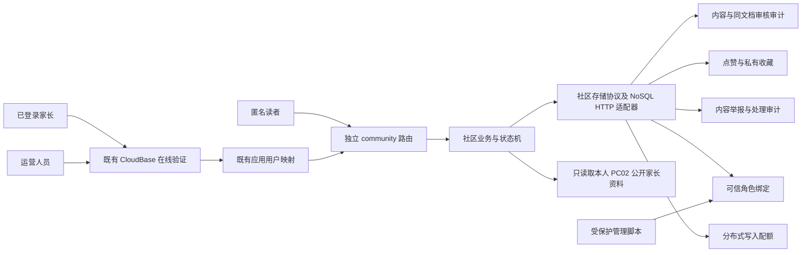

# PC03 家长社区后端架构

状态：本地实施规格；PC03 真实云写入尚未获授权，REAL CLOUD 为 NOT TESTED。

基线：`39bf161b3a584fe545ae20553f3fc6087297d38d`，开发分支 `pc-03-community-backend`。本阶段扩展既有 CloudBase 身份、FastAPI V2 和文档数据库；PC01 页面继续展示明确标注的合成示例，完整前端接入及运营界面属于 PC04。

## 1. 组件与数据边界

模块分工：`community` 的契约、查询、状态机、存储与路由独立于家庭资料 `service.py`；复用既有认证、统一错误、请求限额和安全中间件。生产仅使用 CloudBase HTTP 存储；测试注入 Fake 存储或 Fake HTTP，不允许生产通过配置选择内存 Mock。

匿名路由不解析儿童档案、情绪报告或用户私有会话。社区路由不申请设备权限、不接收音视频、不创建社区前端写入入口。内部 `owner_id`、运营角色和配额身份全部来自服务端验证后的应用用户，客户端不可提交。

## 2. 增量 schema 与集合

独立 manifest：[`003_parent_community.json`](../../cloud/schema/003_parent_community.json)。marker 为 `pc03-parent-community`，owner 为 `SoulCompanion-AI/pc03`，version 为整数 `3`。运行时和工具共享 canonical SHA-256；不得修改 [`001_metadata.json`](../../cloud/schema/001_metadata.json) 或 [`002_family_identity.json`](../../cloud/schema/002_family_identity.json)。

依赖指纹：001 为 `7e23a3c17a1551df1d5a3c7c7c9deb8903f9ea7430fbd38e4fa482e85159fa49`；002 为 `6462a3674be5331748cf5715d81b78dd7c687a6ee326e7a0d95b253c29751324`。运行时社区能力默认关闭，只有精确的新 marker 与旧依赖全部验证后才启用；部分部署或未知响应保持不可用。

新增 **5 个 ADMINONLY 集合、14 个项目索引**；原生 `_id` 索引另计。复用 PC02 `sc_v2_parent_profiles`，不新增作者身份集合。所有 `_id` 等于记录 `id`；时间为服务端规范化 UTC 微秒字符串，ID 为规范 UUID。

| 集合 | 数据及用途 | 所有权 / 成本边界 |
|---|---|---|
| `sc_v2_community_content` | `kind=post/comment`、正文、状态、版本、作者快照、同文档审核历史 | 私有 `owner_id`；评论有父帖 `post_id`。单记录最多 64 KiB、32 项审计；查询必须有界 |
| `sc_v2_community_relations` | `kind=like/bookmark`、`post_id`、`owner_id`、`active`、`row_version`、时间 | 一种关系一条确定性记录；取消改为 inactive，不累计重复关系；收藏仅本人查询 |
| `sc_v2_community_content_reports` | 举报目标与目标正文版本、原因、说明、处理状态及同文档处理历史 | 私有 `reporter_owner_id`；同一举报人对同一目标版本一条记录，后续版本可再次举报 |
| `sc_v2_community_role_bindings` | `principal_id`、角色、授权时间与管理审计 | 仅受保护管理流程写入；HTTP 没有授权或成为管理员接口 |
| `sc_v2_community_write_quotas` | `owner_id`、`action`、UTC 日 `bucket`、`used`、`row_version` | 每用户每动作每天一条计数；不依赖内存，不承诺未经验证的 TTL 自动清理 |

内容记录共同字段：`id`、`kind`、`owner_id`、`public_author_id`、`author_nickname`、`body`、`status`、`content_revision`、`row_version`、`created_at`、`updated_at`、`published_at`、`moderated_at`、首次输入 hash、幂等键 hash、`audit`。帖子另有 `title/age_band/topic`，`post_id=null`；评论的 `post_id` 为父帖 ID，不支持回复层级。

公共 DTO 只白名单输出可公开正文、标签、时间和 `author={id,nickname}`。`author` 来自本人已建立的 PC02 家长资料，创建与正文修改时抓取快照；仅修改家长昵称不会重写既有内容。快照不是孩子昵称、微信自动资料或 CloudBase UID。没有家长昵称时允许浏览，投稿返回明确的 `parent_profile_required`，不要求儿童档案。

### 2.1 索引清单

除标明 `DESC` 外方向均为升序。

| 集合 | 名称 | 字段顺序 | 唯一 |
|---|---|---|---|
| content | `pc03_public_time` | kind, status, published_at DESC, id DESC | 否 |
| content | `pc03_public_age` | kind, status, age_band, published_at DESC, id DESC | 否 |
| content | `pc03_public_topic` | kind, status, topic, published_at DESC, id DESC | 否 |
| content | `pc03_public_age_topic` | kind, status, age_band, topic, published_at DESC, id DESC | 否 |
| content | `pc03_comments_time` | kind, post_id, status, published_at DESC, id DESC | 否 |
| content | `pc03_owner_time` | owner_id, kind, created_at DESC, id DESC | 否 |
| content | `pc03_moderation_queue` | status, updated_at DESC, id DESC | 否 |
| relations | `pc03_relation_unique` | kind, owner_id, post_id | 是 |
| relations | `pc03_relation_count` | kind, post_id, active | 否 |
| relations | `pc03_bookmarks_owner` | kind, owner_id, active, created_at DESC, id DESC | 否 |
| content_reports | `pc03_report_unique` | reporter_owner_id, target_type, target_id, target_revision | 是 |
| content_reports | `pc03_reports_queue` | status, created_at DESC, id DESC | 否 |
| role_bindings | `pc03_role_principal_unique` | principal_id | 是 |
| write_quotas | `pc03_quota_unique` | owner_id, action, bucket | 是 |

年龄、话题两种独立筛选及组合各有排序索引，避免索引前缀缺口。运营队列按状态查询混合内容类型，不做客户端扫全库。列表不执行每帖计数或作者查询；若详情提供计数，只允许有索引的有限次 count，并再次检查父帖可见性。数据库索引仍有存储和写入成本，体验套餐不等于永久免费。

## 3. 审核状态机与单文档原子性

| 操作 | 起始状态 | 结果 |
|---|---|---|
| 投稿 / 评论 | 不存在 | pending，content_revision=1 |
| 作者正文修改 | pending / published / rejected / hidden | pending，正文版本 +1，清空 published_at |
| 审核通过 | pending | published，设置 published_at / moderated_at |
| 审核拒绝 | pending | rejected，清空 published_at |
| 运营隐藏 | pending / published / rejected | hidden，清空 published_at |
| 作者撤回 | 所有非 deleted 状态 | deleted，清空 published_at |

`deleted` 是终态；重复撤回与重复隐藏按明确的幂等语义处理。不能直接将 hidden 变 published，需重新进入 pending 并审核。评论遵守相同状态机；评论审核还需检查父帖当前 published。

每次状态或正文改变递增 `row_version`。操作先读取一个有界文档，再以 `_id + row_version + content_revision + status` 做 CAS；作者操作另带 `owner_id`。普通编辑只能使用允许的业务字段，不能覆盖审核数组。运营决策绑定客户端 `expected_revision`，旧请求不能批准新正文。并发审核、修改、隐藏中只有一个预期版本 CAS 可以成功，其他请求返回冲突或不确定失败。

审计条目为不可变对象，包含操作 ID、服务端 actor、目标正文版本、前后状态、决策、理由、时间。新的状态和完整追加后的有界审计数组在**同一次 PATCH** 中保存，不先发布再独立写日志；既有条目必须逐项保留。举报处理和角色管理也采用同文档 CAS 审计。

审计上限 32：普通编辑及审批完成后的历史最多 30；隐藏可占第 31 项，撤回可占第 32 项。角色授权最多占第 31 项，撤销授权保留第 32 项。历史用尽返回明确错误，不静默轮换、删除或自动归档；异常已公开记录不能绕过公共读取校验。该限制适合首版资源边界，后续若需要无限历史，必须另行设计、授权独立审计存储。

### 3.1 失败与确认丢失

写入前失败、零匹配的旧版本和非法状态不会发布内容。仅有 `matched=1/updated=1` 等合法确认或能独立查证同一操作 ID 的完整结果，才可返回实际成功。409/500、超时或损坏的响应不等于写入确认；未知错误返回脱敏 503，不能返回虚假成功。

数据库可能提交合法的“审核状态＋审计”后丢失网络确认，此时 HTTP 交付结果为 **INDETERMINATE**。无法在现有分布式协议下保证“所有 503 都完全没写入”，也不能伪造该保证。重试使用相同动作幂等键，查验不可变审计与当前文档，不能盲目重放旧决定。已提交状态必须仍有对应正文版本的完整人工审核证据；缺失或无效证据的内容不得公开。审核成功的历史回执不代表内容目前仍公开，随后编辑或隐藏后的当前状态必须如实返回。

## 4. 分页、关系与父帖可见性

公开帖子和评论按 `(published_at,id)` 降序。游标严格验证类型、规范时间和 UUID，并绑定查询种类与年龄/话题条件；后续查询采用 `published_at < t OR (published_at = t AND id < i)`，不使用 offset。相同时间戳不能造成重复或遗漏。

本人内容按 `(created_at,id)`，运营队列按 `(updated_at,id)`。运营队列属于会变化的工作队列，不声称数据库快照隔离；公开内容删除、隐藏或重新发布也会改变集合，游标保证排序边界而非跨请求事务快照。

默认 page size 20，上限 50；最多读取 `limit+1` 判断下一页。返回记录必须再次匹配服务端查询和排序，异常查询返回 fail-closed。列表不请求总数。

收藏先读取最多 `limit+1` 条关系，再用最多 50 个 ID 的单次 `$in` 查询读取当前页仍公开的父帖，过滤不可见帖子；游标沿最后**扫描**的关系推进，允许空页，不无限补齐。关系永远不向其他用户或匿名用户公开。

评论、详情及关系入口必须检查父帖当前可见；评论列表查询前后重新核验父帖。互动过程中父帖可能隐藏，最终核验不可见时返回 404，已经保存的关系留存但不会公开。不能因为评论自身 published 就跳过父帖检查。已返回给读者的历史响应无法被撤回，不承诺超出请求读取边界的线性快照。

## 5. 幂等与分布式配额

投稿、评论和审核动作使用安全 ASCII 幂等键，最多 64 字符。投稿、评论按业务类型、服务端 owner 与键计算确定性 UUID，保存规范化首次输入 SHA-256；相同输入收敛为同一资源，不同输入复用键返回 409。数据库重复主键响应必须再读取并检查完整归属/hash，不能将“先查询再写入”当成唯一性保证。

点赞与收藏按 kind/owner/post 生成确定性键，保存 active 与版本，唯一索引作第二层保护；相同状态重复请求不增加关系。相反状态并发通过 CAS 冲突处理。举报按 reporter/target_type/target_id/服务端当前正文版本确定键并使用唯一索引；当前版本重复输入幂等、不同输入冲突，目标版本由服务端读取。

| UTC 日动作配额 | post | comment | report | relation | moderation |
|---|---:|---:|---:|---:|---:|
| 每位验证用户上限 | 10 | 100 | 20 | 200 | 200 |

配额初始化使用确定性主键；读取 used 后以当前计数与版本 CAS 递增，最多三次重试。配额先于业务改变，故失败可能消耗次数；未知结果不退款，避免并发重复释放。成功确认后才允许后续写入；配额存储不可用、计数损坏或竞争预算用尽必须拒绝。重复已经确认的业务请求不再次消费配额。

这是按用户的分布式尝试配额，不是全面反滥用系统：UTC 日边界最多允许相邻两天额度的突发量，不能阻止注册多账号、匿名分布式读取或全部资源耗尽。保留既有网关与实例限流；不通过关闭限流提高测试通过率。旧配额记录暂不自动删除，清理需后续受保护管理计划。

撤回不扣贡献配额，防止配额耗尽阻止家长收回自己的公开内容；所有权、版本与审计仍严格验证。受保护 CLI 的 grant 要求 active 用户，revoke 验证旧角色绑定而不依赖用户仍 active，避免禁用账号留下无法撤销的运营角色。

## 6. 身份、文本与人工审核

复用既有在线 token introspection 与应用用户映射，不能自行签发替代 JWT、信任客户端 UID 或缓存过期身份以绕过撤销检查。运营角色在每次运营请求查询服务端绑定；初始授权仅由持有已有管理权限的受保护 CLI 完成，并生成管理审计。普通家长没有任何角色写入路由。

文本使用 NFC、严格 UTF-8；正文可保留 LF，控制字符、双向控制字符、HTML 标签和危险嵌入必须拒绝。上限：标题 80、正文 2000、评论 1000、举报说明 500、审核理由 200 个 Unicode 字符；现有请求体 16384 字节总上限仍生效，审计理由最多 800 UTF-8 字节。纯文本输入不能变成查询操作符或脚本，后续前端只能以纯文本渲染。

字段白名单不能自动去掉正文中的姓名、学校、住址或病史。投稿契约和 PC04 界面需提醒不要公开儿童个人信息；人工审核必须检查儿童身份信息、可定位细节、公共照片、骚扰及诊断/医疗断言。没有完成自动脱敏、平台安全服务或 AI 审核，不能作出这些能力声明。

## 7. 预算、实施和验证

保留 API 2.6 秒请求预算与历史 Python 3.11 / 256 MB / 3 秒函数边界，实施前重新只读核查真实配置。查询有限页，独立读取可受限并行；不同步调用外部 AI。超时安全失败，不增加预算掩盖慢查询，不允许后台无期限重试。

选择单文档 CAS 的好处是复用已有生产协议、审计和状态原子、减少事务往返；代价是有界历史和保守配额。分开帖子/评论集合与独立审核日志较直观，但增加集合或跨文档原子性要求。官方 SDK 存在事务入口，不代表本环境已验证事务；PC03 不依赖该能力。

协议证据：现有 [`repository.py`](../../cloud/api/soulcompanion_cloud/repository.py) 已用 POST 确定性主键、条件 PATCH、双字段 order 和 count。安装的官方 JS SDK 3.10.1 的 `database/dist/index.js` 使用相同 REST 方法和参数。[官方数据库文档](https://docs.cloudbase.net/api-reference/openapi/database)说明 `$or/$lt` 等操作符与更新计数，但其管理入口不同；[官方 Flutter 文档](https://docs.cloudbase.net/api-reference/flutter)说明对齐 HTTP 的 NoSQL 查询能力。新增查询形状必须有 Fake HTTP 协议测试；当前不宣称新增操作 REAL CLOUD PASS。

增量执行器默认离线 plan，apply 需本阶段明确授权与双参数门槛；读取实际 DescribeEnvInfo 的环境、地域及唯一 RUNNING 数据库，核对费用、旧 fingerprint、ADMINONLY、索引名称/字段及 marker，部分失败保留带唯一 reservation_id 的 version0，完成后 CAS 发布 version3。DescribeTable 实际响应没有独立索引构建状态字段，只报告回读定义验证，不伪造构建状态。重复完成 apply 只读验证，禁止删表、回填、覆盖用户数据或修改旧 marker。

真实目标沿用 `soulcompanion-dev-d0dzo6f2a24211` / `ap-shanghai` / `tnt-28wj48qn2` / 既有 `sc-v2-api`，但昵称或旧授权都不是本阶段写入许可。新增资源、函数代码更新、费用与回滚必须在 [云变更计划](PC03_CLOUD_CHANGE_PLAN.md)形成具体方案后暂停申请授权。独立部署工具仅更新既有函数代码，保留经 checksum 固定的 PC02 回滚包，并在私有本地目录冻结 source-approved PC03 包用于后续前向更新与回滚归属核验。恢复 PC02 代码会停用社区路由，但不修改 marker、不删除新集合或数据；停用 marker 本身不在部署工具范围内。

测试包括路由权限、隐藏父帖、历史审核版本、非法字段/UTF-8、幂等唯一关系、相同时间游标、CAS 并发、审计容量、配额竞争、失联确认、schema 幂等与错误环境，及全部 Phase04/PC02 回归。状态必须区分 AUTOMATED PASS、REAL CLOUD、微信 DevTools 与真机；Fake 不替代真实云或微信验收。

参见 [API 契约](PC03_API_CONTRACT.md)。
